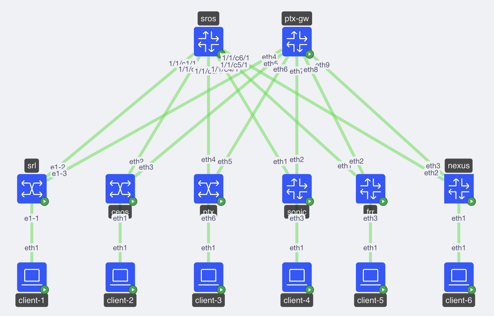

# Multivendor EVPN/VXLAN Lab

A [ContainerLab](https://containerlab.dev/) topology that demonstrates **L2 EVPN/VXLAN interoperability** across four different network operating systems in a 2-tier CLOS fabric.

## Topology



### Nodes

| Node | Role | NOS | Image |
|------|------|-----|-------|
| `sros` | Spine / Route Reflector | Nokia SROS 25.10.R2 | nokia_srsim:25.10.R2 |
| `ptx-gw` | Spine / DC Gateway | Juniper cJunos Evolved | juniper_cjunosevolved:25.4R1.13-EVO |
| `srl` | Leaf | Nokia SR Linux 25.10.1 | ghcr.io/nokia/srlinux:25.10.1 |
| `ceos` | Leaf | Arista EOS 4.34.2F | arista_ceos:4.34.2F |
| `ptx` | Leaf | Juniper cJunos Evolved | juniper_cjunosevolved:25.4R1.13-EVO |
| `sonic` | Leaf | SONiC (FRR-based control plane) | vrnetlab/sonic_sonic-vs:26 |
| `frr` | Leaf (FRR router) | FRRouting | quay.io/frrouting/frr:containerlab-10.7.1 |
| `client-{1,2,3,4,5}` | Hosts | Linux | ghcr.io/hellt/network-multitool:latest |

> **Note:** The `vrnetlab/sonic_sonic-vs:26` and `quay.io/frrouting/frr:containerlab-10.7.1` image tags don't pin an exact software version — confirm what's actually running with `show version`:

```
admin@sonic:~$ show version

SONiC Software Version: SONiC.master.1226279-9ee071bd2
SONiC OS Version: 13
Distribution: Debian 13.6
Kernel: 6.12.41+deb13-sonic-amd64
Build commit: 9ee071bd2
Build date: Mon Sep 21 16:49:18 UTC 2026
Built by: azureuser@41337783c000000

Platform: x86_64-kvm_x86_64-r0
HwSKU: Force10-S6000
ASIC: vs
ASIC Count: 1
Serial Number: N/A
Model Number: N/A
Hardware Revision: N/A
Uptime: 18:42:22 up 8 min,  2 users,  load average: 0.05, 0.50, 0.45
Date: Tue 22 Sep 2026 18:42:22

Docker images:
REPOSITORY                    TAG                        IMAGE ID       SIZE
docker-snmp                   latest                     0ef5f614df46   331MB
docker-snmp                   master.1226279-9ee071bd2   0ef5f614df46   331MB
docker-syncd-vs               latest                     f661ca78e3f9   2.53GB
docker-syncd-vs               master.1226279-9ee071bd2   f661ca78e3f9   2.53GB
docker-macsec                 latest                     58b90ea25d52   347MB
docker-macsec                 master.1226279-9ee071bd2   58b90ea25d52   347MB
docker-platform-monitor       latest                     8ef85802cd61   425MB
docker-platform-monitor       master.1226279-9ee071bd2   8ef85802cd61   425MB
docker-dash-engine            latest                     041afb6576b9   1.34GB
docker-dash-engine            master.1226279-9ee071bd2   041afb6576b9   1.34GB
docker-gnmi-sidecar           latest                     c6190b1fd07b   304MB
docker-gnmi-sidecar           master.1226279-9ee071bd2   c6190b1fd07b   304MB
docker-sonic-p4rt             latest                     ea6c4d8a37ef   406MB
docker-sonic-p4rt             master.1226279-9ee071bd2   ea6c4d8a37ef   406MB
docker-router-advertiser      latest                     1e12ae9c47f8   304MB
docker-router-advertiser      master.1226279-9ee071bd2   1e12ae9c47f8   304MB
docker-bmp-watchdog           latest                     2bca986e203f   302MB
docker-bmp-watchdog           master.1226279-9ee071bd2   2bca986e203f   302MB
docker-database               latest                     9276b84a8726   311MB
docker-database               master.1226279-9ee071bd2   9276b84a8726   311MB
docker-restapi-sidecar        latest                     2f95f56feed3   304MB
docker-restapi-sidecar        master.1226279-9ee071bd2   2f95f56feed3   304MB
docker-nat                    latest                     3da8c7d71498   347MB
docker-nat                    master.1226279-9ee071bd2   3da8c7d71498   347MB
docker-sflow                  latest                     522ee758a405   346MB
docker-sflow                  master.1226279-9ee071bd2   522ee758a405   346MB
docker-fpm-frr                latest                     61a00b31fa22   409MB
docker-fpm-frr                master.1226279-9ee071bd2   61a00b31fa22   409MB
docker-sonic-gnmi             latest                     718128c9ee6f   460MB
docker-sonic-gnmi             master.1226279-9ee071bd2   718128c9ee6f   460MB
docker-orchagent              latest                     2a96fc9df32e   360MB
docker-orchagent              master.1226279-9ee071bd2   2a96fc9df32e   360MB
docker-sonic-bmp              latest                     feed2dd587da   305MB
docker-sonic-bmp              master.1226279-9ee071bd2   feed2dd587da   305MB
docker-gnmi-watchdog          latest                     084b5074f263   309MB
docker-gnmi-watchdog          master.1226279-9ee071bd2   084b5074f263   309MB
docker-dhcp-relay             latest                     c49c0898b00d   346MB
docker-dhcp-relay             master.1226279-9ee071bd2   c49c0898b00d   346MB
docker-dash-ha                latest                     4313f4ff3435   364MB
docker-dash-ha                master.1226279-9ee071bd2   4313f4ff3435   364MB
docker-sonic-otel             latest                     df1c63c7303c   646MB
docker-sonic-otel             master.1226279-9ee071bd2   df1c63c7303c   646MB
docker-eventd                 latest                     ab21177f7897   304MB
docker-eventd                 master.1226279-9ee071bd2   ab21177f7897   304MB
docker-mux                    latest                     ad9f940f1ba4   318MB
docker-mux                    master.1226279-9ee071bd2   ad9f940f1ba4   318MB
docker-gbsyncd-vs             latest                     c251116f2fd1   2.53GB
docker-gbsyncd-vs             master.1226279-9ee071bd2   c251116f2fd1   2.53GB
docker-sysmgr                 latest                     2214b22c63f3   309MB
docker-sysmgr                 master.1226279-9ee071bd2   2214b22c63f3   309MB
docker-sonic-mgmt-framework   latest                     5fd1a452b39c   369MB
docker-sonic-mgmt-framework   master.1226279-9ee071bd2   5fd1a452b39c   369MB
docker-teamd                  latest                     affa71bdd8cc   344MB
docker-teamd                  master.1226279-9ee071bd2   affa71bdd8cc   344MB
docker-lldp                   latest                     1574ee97f985   313MB
docker-lldp                   master.1226279-9ee071bd2   1574ee97f985   313MB
```

```
admin@sonic:~$ vtysh

Hello, this is FRRouting (version 10.5.4).
Copyright 1996-2005 Kunihiro Ishiguro, et al.

sonic# show version
FRRouting 10.5.4 (sonic) on Linux(6.12.41+deb13-sonic-amd64).
Copyright 1996-2005 Kunihiro Ishiguro, et al.
configured with:
    '--build=x86_64-linux-gnu' '--prefix=/usr' '--includedir=${prefix}/include' '--mandir=${prefix}/share/man' '--infodir=${prefix}/share/info' '--sysconfdir=/etc' '--localstatedir=/var' '--disable-option-checking' '--disable-silent-rules' '--libdir=${prefix}/lib/x86_64-linux-gnu' '--libexecdir=${prefix}/lib/x86_64-linux-gnu' '--disable-maintainer-mode' '--sbindir=/usr/lib/frr' '--with-vtysh-pager=/usr/bin/pager' '--libdir=/usr/lib/x86_64-linux-gnu/frr' '--with-moduledir=/usr/lib/x86_64-linux-gnu/frr/modules' '--disable-dependency-tracking' '--disable-rpki' '--disable-scripting' '--enable-pim6d' '--disable-grpc' '--disable-address-sanitizer' '--enable-gperf-tcmalloc' '--with-libpam' '--enable-doc' '--enable-doc-html' '--enable-snmp' '--enable-fpm' '--enable-sharpd' '--disable-protobuf' '--disable-zeromq' '--enable-ospfapi' '--enable-multipath=514' '--enable-pcre2posix' '--enable-user=frr' '--enable-group=frr' '--enable-vty-group=frrvty' '--enable-configfile-mask=0640' '--enable-logfile-mask=0640' 'build_alias=x86_64-linux-gnu' 'PYTHON=python3'
```

### Links

Each leaf has a full-mesh uplink to both spines. Clients connect to their respective leaf on access (trunk) ports:

| Link | Interface A | Interface B |
|------|-------------|-------------|
| sros → srl | 1/1/c1/1 | e1-2 |
| sros → ceos | 1/1/c2/1 | eth2 |
| sros → ptx | 1/1/c3/1 | eth2 |
| ptx-gw → srl | eth1 | e1-3 |
| ptx-gw → ceos | eth2 | eth3 |
| ptx-gw → ptx | eth3 | eth3 |
| srl → client-1 | e1-1 | eth1 |
| ceos → client-2 | eth1 | eth1 |
| ptx → client-3 | eth1 | eth1 |
| sros → sonic | 1/1/c4/1 | eth1 |
| ptx-gw → sonic | eth7 | eth2 |
| sros → frr | 1/1/c5/1 | eth1 |
| ptx-gw → frr | eth8 | eth2 |
| sonic → client-4 | eth3 | eth1 |
| frr → client-5 | eth3 | eth1 |

## Protocols

### Underlay — OSPF

All fabric interfaces (dot1q VLAN 1) and loopbacks run **OSPFv2 area 0**, point-to-point. MTU is set to 9194 / 9172 bytes on fabric links.

| Node | Loopback / System IP |
|------|---------------------|
| sros | 192.1.2.1/32 |
| ptx-gw | 192.1.2.2/32 |
| srl | 192.1.1.1/32 |
| ceos | 192.1.1.2/32 |
| ptx | 192.1.1.3/32 |
| sonic | 192.1.1.4/32 |
| frr | 192.1.1.5/32 |

### Overlay — BGP EVPN / VXLAN

| Parameter | Value |
|-----------|-------|
| BGP AS | 65000 (iBGP) |
| Route Reflector | `sros` (cluster-id 192.1.2.1) |
| EVPN mode | VLAN-aware bundle |
| VLAN | 10 |
| VNI | 1010 |
| EVI | 10 |
| Route-target | `target:65000:10` |
| EVPN eth-tag | 1010 |

All leaf VTEP IPs are their loopback addresses. EVPN type-2 (MAC/IP) and type-3 (IMET) routes are exchanged via iBGP.

### Clients

Clients are configured with a VLAN 10 sub-interface and assigned addresses in `192.168.10.0/24`:

| Client | VLAN | IP | MAC |
|--------|------|----|-----|
| client-1 | 10 | 192.168.10.11/24 | 00:c1:ab:00:00:01 |
| client-2 | 10 | 192.168.10.12/24 | 00:c1:ab:00:00:02 |
| client-3 | 10 | 192.168.10.13/24 | 00:c1:ab:00:00:03 |
| client-4 | 10 | 192.168.10.14/24 | 00:c1:ab:00:00:04 |
| client-5 | 10 | 192.168.10.15/24 | 00:c1:ab:00:00:05 |

## Requirements

- [ContainerLab](https://containerlab.dev/install/) installed on the host
- Docker with sufficient resources (RAM-heavy: SROS and Juniper nodes each need several GB)
- Nokia SRSIM license file at `../license-srsim25.txt` (one directory above this repo)
- The following images imported locally (not auto-pulled):
  - `nokia_srsim:25.10.R2`
  - `arista_ceos:4.34.2F`
  - `juniper_cjunosevolved:25.4R1.13-EVO`
  - `vrnetlab/sonic_sonic-vs:26` — download master sonic-vs.img.gz from [sonic.software](https://sonic.software/). SONiC-VS is a VM image, not a container image, so it must be wrapped with [vrnetlab](https://github.com/hellt/vrnetlab) (the `sonic-vm`/`sonic-vs` builder) before ContainerLab can boot it as a node. Build image used for this test was [SONiC.master.1226279](https://dev.azure.com/mssonic/build/_build/results?buildId=1226279&view=results).
  - `quay.io/frrouting/frr:containerlab-10.7.1` — download from [frrouting.org/release](https://frrouting.org/release/), or pull directly from repo `quay.io/frrouting/frr:containerlab-10.7.1`.

## Deploying the lab

```bash
# Deploy
sudo clab deploy -t multivendor.clab.yml

# Redeploy from scratch (wipes node state)
sudo clab deploy -t multivendor.clab.yml --reconfigure

# Check running nodes and management IPs
sudo clab inspect -t multivendor.clab.yml

# Destroy
sudo clab destroy -t multivendor.clab.yml
```

## Post-deploy configuration

A few nodes are **not** fully configured by ContainerLab's `startup-config` mechanism and need manual steps after `clab deploy` finishes.

### SONiC (`mv-sonic`)

The `sonic-vm` kind only loads `config_db.json` on boot — interfaces, OSPF, and BGP/EVPN on the internal FRR control plane still need to be wired up. Run `startup_config/post-deploy-sonic.sh` once against the node's SSH target to inject an SSH key, configure interface IPs/MTUs, enable `ospfd`, and apply OSPF + BGP EVPN config via `vtysh`:

```bash
./startup_config/post-deploy-sonic.sh mv-sonic
```

The script is idempotent — safe to re-run against a node that's already configured.

### Juniper cJunos Evolved (`mv-ptx-gw` and `mv-ptx`)

The `ptx-gw` and `ptx` nodes have their `startup-config` entries commented out in `multivendor.clab.yml`, so `ptxgw.cfg` and `ptx.cfg` must be applied by hand after deploy. SSH into each node, enter configuration mode, and paste in the contents of the matching file:

```bash
# ptx-gw — paste the contents of startup_config/ptxgw.cfg
ssh admin@mv-ptx-gw
configure
<paste contents of startup_config/ptxgw.cfg>
commit

# ptx — paste the contents of startup_config/ptx.cfg
ssh admin@mv-ptx
configure
<paste contents of startup_config/ptx.cfg>
commit
```

## Accessing nodes

| Node | Management IP | Credentials |
|------|--------------|-------------|
| mv-sros | 172.20.20.34 | admin / NokiaSros1! |
| mv-ptx-gw | 172.20.20.10 | admin / admin@123 |
| mv-srl | 172.20.20.35 | admin / NokiaSrl1! |
| mv-ceos | 172.20.20.7 | admin / admin |
| mv-ptx | 172.20.20.8 | admin / admin@123 |
| mv-sonic | 172.20.20.17 | admin / YourPaSsWoRd |
| mv-frr | — (shell access only, see below) | — |

> **Note:** Management IPs are assigned by ContainerLab and may differ between deployments. Always verify with `clab inspect`.

```bash
# SSH into any node
ssh admin@<Node>

# SR Linux — alternative via Docker
docker exec -it mv-srl sr_cli

# SONiC — ssh in, then configure interfaces from bash or drop into vtysh for routing
ssh admin@mv-sonic
vtysh

# FRR — no SSH; get a shell via Docker, then vtysh for routing config
docker exec -it mv-frr sh
vtysh
```

## Verifying the lab

### Check OSPF neighbors (on sros)
```
show router ospf neighbor
```

### Check BGP EVPN sessions (on sros)
```
show router bgp neighbor
```

### Check EVPN routes (on srl)
```
show network-instance default protocols bgp routes evpn
```

### Ping between clients
```bash
# From client-1
docker exec mv-client-1 ping 192.168.10.12 -c 3   # → client-2 via ceos
docker exec mv-client-1 ping 192.168.10.13 -c 3   # → client-3 via ptx
```

### Expected output — all sessions up (on `mv-sros`)

Once the underlay and overlay are up (including the post-deploy steps above), `sros` should show a full OSPF adjacency and iBGP EVPN session to every other node in the fabric. Sample output — replace with the real output from your own deployment:

```
A:admin@sros# show router ospf neighbor 

===============================================================================
Rtr Base OSPFv2 Instance 0 Neighbors
===============================================================================
Interface-Name                   Rtr Id          State      Pri  RetxQ   TTL
   Area-Id
-------------------------------------------------------------------------------
to_ceos                          192.1.1.2       Full       0    0       31
   0.0.0.0
to_frr                           192.1.1.5       Full       1    0       37
   0.0.0.0
to_ptx                           192.1.1.3       Full       128  0       30
   0.0.0.0
to_sonic                         192.1.1.4       Full       1    0       32
   0.0.0.0
to_srl                           192.1.1.1       Full       1    1       35
   0.0.0.0
-------------------------------------------------------------------------------
No. of Neighbors: 5
===============================================================================
```

```
A:admin@sros# show router bgp summary
===============================================================================
 BGP Router ID:192.1.2.1        AS:65000       Local AS:65000      
===============================================================================
BGP Admin State         : Up          BGP Oper State              : Up
Total Peer Groups       : 1           Total Peers                 : 5         
Total VPN Peer Groups   : 0           Total VPN Peers             : 0         
Current Internal Groups : 1           Max Internal Groups         : 1         
Total BGP Paths         : 35          Total Path Memory           : 12944     
Memory Failures         : 0           Label Failures              : 0         
Next Hop Failures       : 0           Backup Path Failures        : 0         
Tunnel Failures         : 0           Tunnel Next Hop Failures    : 0         
 
Total IPv4 Remote Rts   : 0           Total IPv4 Rem. Active Rts  : 0         
Total IPv6 Remote Rts   : 0           Total IPv6 Rem. Active Rts  : 0         
Total IPv4 Backup Rts   : 0           Total IPv6 Backup Rts       : 0         
Total LblIpv4 Rem Rts   : 0           Total LblIpv4 Rem. Act Rts  : 0         
Total LblIpv6 Rem Rts   : 0           Total LblIpv6 Rem. Act Rts  : 0         
Total LblIpv4 Bkp Rts   : 0           Total LblIpv6 Bkp Rts       : 0          
Total Supressed Rts     : 0           Total Hist. Rts             : 0         
Total Decay Rts         : 0         
 
Total VPN-IPv4 Rem. Rts : 0           Total VPN-IPv4 Rem. Act. Rts: 0         

Total VPN-IPv6 Rem. Rts : 0           Total VPN-IPv6 Rem. Act. Rts: 0         
Total VPN-IPv4 Bkup Rts : 0           Total VPN-IPv6 Bkup Rts     : 0         
Total VPN Local Rts     : 0           Total VPN Supp. Rts         : 0         
Total VPN Hist. Rts     : 0           Total VPN Decay Rts         : 0         
 
Total MVPN-IPv4 Rem Rts : 0           Total MVPN-IPv4 Rem Act Rts : 0         
Total MVPN-IPv6 Rem Rts : 0           Total MVPN-IPv6 Rem Act Rts : 0         
Total MDT-SAFI Rem Rts  : 0           Total MDT-SAFI Rem Act Rts  : 0         
Total McIPv4 Remote Rts : 0           Total McIPv4 Rem. Active Rts: 0         
Total McIPv6 Remote Rts : 0           Total McIPv6 Rem. Active Rts: 0         
Total McVpnIPv4 Rem Rts : 0           Total McVpnIPv4 Rem Act Rts : 0         
Total McVpnIPv6 Rem Rts : 0           Total McVpnIPv6 Rem Act Rts : 0         
 
Total EVPN Rem Rts      : 2           Total EVPN Rem Act Rts      : 0         
Total L2-VPN Rem. Rts   : 0           Total L2VPN Rem. Act. Rts   : 0         
Total MSPW Rem Rts      : 0           Total MSPW Rem Act Rts      : 0         
Total RouteTgt Rem Rts  : 0           Total RouteTgt Rem Act Rts  : 0         
Total FlowIpv4 Rem Rts  : 0           Total FlowIpv4 Rem Act Rts  : 0         
Total FlowIpv6 Rem Rts  : 0           Total FlowIpv6 Rem Act Rts  : 0         
Total FlowVpnv4 Rem Rts : 0           Total FlowVpnv4 Rem Act Rts : 0         
Total FlowVpnv6 Rem Rts : 0           Total FlowVpnv6 Rem Act Rts : 0         
Total Link State Rem Rts: 0           Total Link State Rem Act Rts: 0         
Total SrPlcyIpv4 Rem Rts: 0           Total SrPlcyIpv4 Rem Act Rts: 0         
Total SrPlcyIpv6 Rem Rts: 0           Total SrPlcyIpv6 Rem Act Rts: 0         

===============================================================================
BGP Summary
===============================================================================
Legend : D - Dynamic Neighbor
===============================================================================
Neighbor
Description
                   AS PktRcvd InQ  Up/Down   State|Rcv/Act/Sent (Addr Family)
                      PktSent OutQ
-------------------------------------------------------------------------------
192.1.1.1
                65000     120    0 00h54m30s 1/0/2 (Evpn)
                          127    0           
192.1.1.2
                65000     122    0 00h48m21s 1/0/2 (Evpn)
                          114    0           
192.1.1.3
                65000     113    0 00h50m06s 0/0/2 (Evpn)
                          118    0           
192.1.1.4
                65000     105    0 00h51m12s 0/0/2 (Evpn)
                          120    0           
192.1.1.5
                65000     112    0 00h54m30s 0/0/2 (Evpn)
                          127    0           
```

## Automation inventories

ContainerLab auto-generates two inventory files on deploy inside `clab-mv/`:

- `clab-mv/ansible-inventory.yml` — grouped by NOS, connection type pre-configured
- `clab-mv/nornir-simple-inventory.yml` — Nornir SimpleInventory format
